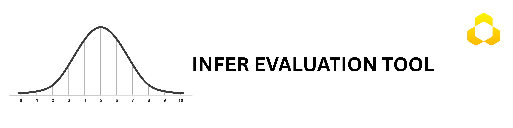

# 모델 평가 지표의 신뢰구간

**Language / 언어:** [English](README.md) | **한국어**


[](https://opensource.org/licenses/MIT)
[](https://www.python.org/downloads/)

infer-ci는 정확도(Accuracy), 평균 제곱 오차(MSE) 등 머신러닝 평가 지표를 계산하고, 부트스트랩을 비롯한 여러 방법으로 신뢰구간을 함께 반환하는 표준화된 평가 도구입니다.

# 신뢰할 수 있는 AI 모델 평가에 신뢰구간이 필요한 이유

실무에서는 작거나 계속 달라지는 테스트 데이터에서 계산한 단일 지표값으로 모델의 배포 여부를 결정하는 경우가 많습니다. 지표의 변동성이 크면 데이터, 난수 시드, 표본의 작은 차이가 실제로는 존재하지 않는 성능 저하나 개선처럼 보일 수 있습니다. 이로 인해 불필요한 작업이 반복되고, 관계자 간 신뢰와 배포 판단의 안정성이 떨어질 수 있습니다.

한 사례로, HumbleBee.AI 설립 전 Jumabek Alikhan의 동료는 독일 고객을 위한 YOLO 객체 탐지 모델을 개발하고 있었습니다. 작은 테스트 데이터로 처음 평가했을 때 mAP는 약 40%였지만, 데이터를 추가하고 학습·테스트 범위를 넓힌 뒤에는 약 36%로 낮아졌습니다. 고객은 모델 성능이 저하됐다고 판단했고, Jumabek이 원인을 살펴보게 됐습니다. 문제는 YOLO의 버그가 아니라 통계적 불확실성이었습니다. 작은 테스트 데이터에서 나온 40%의 95% 신뢰구간은 약 20%–60%로 매우 넓었고, 더 큰 데이터에서 나온 36%의 신뢰구간은 약 30%–42%로 더 좁고 안정적이었습니다. 이 불확실성을 설명하면서 평가 결과에 대한 이견을 해소하고 모델의 실제 성능 변화를 함께 이해할 수 있었습니다.

평가를 단일 점수가 아닌 통계적 추론으로 바라보는 관점은 이후 HumbleBee.AI의 모델 평가 방식에도 이어졌습니다. infer-ci는 이러한 원칙을 오픈 소스 라이브러리로 제공해, 팀이 기존 평가 지표에 신뢰구간을 더하고 근거에 따라 배포 여부를 판단할 수 있도록 돕습니다.

## 개발 배경

성능 추정값을 제시할 때 신뢰구간을 함께 계산하는 방법은 아직 충분히 연구되지 않았습니다. 의료 통계, AutoML, 텍스트 분류 등 여러 분야에서 다양한 신뢰구간 추정 방법이 제안됐으며, 방법마다 가정과 장점, 한계가 다릅니다. 다만 많은 방법이 하나의 지표나 제한된 모델 유형에 맞춰져 있어 폭넓게 적용하기 어렵습니다.

infer-ci는 모델 평가 지표와 신뢰구간을 계산하는 표준화된 도구입니다. 부트스트랩, Wald, Wilson 등 여러 신뢰구간 계산 방법과 시각화를 제공하며, ML·CV·LLM 평가에 활용할 수 있습니다.

## 설치

### PyPI에서 설치 (권장)

```bash
pip install infer-ci
```

### 소스 코드로 설치 (개발용)

```bash
git clone https://github.com/humblebeeai/infer-ci.git
cd infer-ci
pip install -e ".[dev]"
```

가상환경 설정은 [설치 안내](docs/getting-started/installation.ko.md)를 참고하세요.

## 시작하기

```python
# All the possible imports:
from infer_ci import MetricEvaluator
from infer_ci import accuracy_score, precision_score, tpr_score, f1_score
from infer_ci import mae, mse, rmse, r2_score, iou

# Classification example:
y_true = [0, 1, 1, 0, 1]
y_pred = [0, 1, 0, 0, 1]

evaluator = MetricEvaluator()

accuracy, ci = evaluator.evaluate(
    y_true=y_true,
    y_pred=y_pred,
    task='classification',
    metric='accuracy',
    method='wilson'
)
```

## 신뢰구간 계산 방법과 기본값

`MetricEvaluator.evaluate()`의 기본 방법은 `method='bootstrap_bca'`입니다. BCa 부트스트랩은 추정값의 편향과 비대칭성을 보정합니다. 지표 함수를 직접 호출하면 함수별 기본값이 적용됩니다. 예를 들어 `accuracy_score()`는 Wilson, `f1_score()`는 Takahashi 방법을 사용합니다. 모든 지표가 모든 신뢰구간 계산 방법을 지원하는 것은 아닙니다.

선택한 지표가 지원하는 방법을 지정하세요. 예를 들어 정확도에는 `method='wilson'`, 부트스트랩 재표집에는 `method='bootstrap_percentile'`을 사용할 수 있습니다. 회귀 지표는 `method='jackknife'`도 지원합니다. 같은 데이터와 라이브러리 버전에서 부트스트랩 결과를 재현하려면 `random_state`를 지정하세요.

## 지원하는 방법

- **분석적 방법**: Wilson, Normal, Agresti-Coull, Beta, Jeffreys, Binomial test
- **부트스트랩 방법**: Basic, Percentile, Bias-Corrected and Accelerated(BCa, `MetricEvaluator.evaluate()`의 기본값)
- **잭나이프 방법**: Jackknife

**MetricEvaluator에서 사용할 수 있는 주요 지표:**

**분류:**

- `accuracy`: 전체 분류 정확도
- `precision`: 정밀도(양성 예측도, PPV)
- `recall`: 재현율(참양성률·민감도, TPR)
- `specificity`: 특이도(참음성률, TNR)
- `npv`: 음성 예측도
- `fpr`: 위양성률
- `f1`: F1 점수(평균 방식 지정 가능)
- `precision_takahashi`: Takahashi 방법을 사용하는 정밀도
- `recall_takahashi`: Takahashi 방법을 사용하는 재현율
- `auc`: ROC AUC 점수

**회귀:**

- `mae`: 평균 절대 오차
- `mse`: 평균 제곱 오차
- `rmse`: 평균 제곱 오차의 제곱근
- `r2`: 결정계수
- `mape`: 평균 절대 백분율 오차
- `iou`: 교집합과 합집합의 비율(Intersection over Union)

**객체 탐지 (전체 및 클래스별 지원):**

- `map`: mAP @0.5:0.95
- `map50`: mAP @0.5
- `precision`: 탐지 정밀도
- `recall`: 탐지 재현율

📖 객체 탐지 지표의 사용 예제는 [객체 탐지 지표 안내 (English)](docs/object-detection-metrics-usage.md)를 참고하세요.

📚 [온라인 버전 사용하기](https://infer.humblebee.ai)

사용 가능한 방법과 지표를 코드로 확인할 수도 있습니다. 반환 목록은 작업 유형별 요약이며, 개별 지표마다 지원 범위가 다를 수 있습니다.

```python
from infer_ci import MetricEvaluator

evaluator = MetricEvaluator()
for task in ['classification', 'regression', 'detection']:
    print(f"{task} methods:", evaluator.get_available_methods(task))
    print(f"{task} metrics:", evaluator.get_available_metrics(task))
```

여기서 사용하는 분석적 계산은 아래 참고 문헌에 있는 Takahashi 등의 2022년 논문을 바탕으로 합니다. 해당 논문은 micro 평균의 재현율과 정밀도를 유도합니다. 이 프로젝트는 델타 방법을 사용해 macro F1 등의 신뢰구간 계산도 구현합니다.

## 분류 보고서 만들기

`classification_report_with_ci`는 주요 분류 지표와 신뢰구간을 포함하는 텍스트 보고서를 만듭니다. 먼저 각 클래스를 이진 분류 문제로 취급합니다. 클래스별 정밀도와 재현율의 기본 신뢰구간 계산 방법은 Wilson이고, F1은 이진 Takahashi 방법을 사용합니다. 이후 다중 클래스의 micro·macro 지표를 Takahashi 방법으로 계산합니다.

```python
from infer_ci import classification_report_with_ci

y_true = [0, 1, 2, 2, 2, 1, 1, 1, 0, 2, 2, 1, 0, 2, 2, 1, 2, 2, 1, 1]
y_pred = [0, 1, 0, 0, 2, 1, 1, 1, 0, 2, 2, 1, 0, 1, 2, 1, 2, 2, 1, 1]

classification_report_with_ci(y_true, y_pred)
```

출력 예시:

```text
     Class  Precision  Recall  F1-Score    Precision CI       Recall CI     F1-Score CI  Support
0  Class 0      0.600   1.000     0.750  (0.231, 0.882)    (0.439, 1.0)  (0.408, 1.092)        3
1  Class 1      0.889   1.000     0.941   (0.565, 0.98)    (0.676, 1.0)  (0.796, 1.086)        8
2  Class 2      1.000   0.667     0.800     (0.61, 1.0)  (0.354, 0.879)  (0.562, 1.038)        9
3    micro      0.850   0.850     0.850  (0.694, 1.006)  (0.694, 1.006)  (0.694, 1.006)       20
4    macro      0.830   0.889     0.830  (0.702, 0.958)  (0.775, 1.002)  (0.548, 1.113)       20
```

## F1의 binary·macro·micro 평균

`average='binary'`에는 이진 레이블을 사용하세요. 정밀도와 재현율도 평균 방식을 지원하며, 선택한 지표에서 지원하는 계산 방법을 확인해야 합니다.

```python
from infer_ci import f1_score

# Synthetic data for demonstrating the averaging API.
y_true = [0, 1, 1, 0, 1, 0, 1, 0] * 10
y_pred = [0, 1, 0, 0, 1, 1, 1, 0] * 10

for average in ['binary', 'macro', 'micro']:
    value, ci = f1_score(
        y_true, y_pred, confidence_level=0.95,
        average=average, method='takahashi'
    )
    print(f"{average}: {value:.3f} [{ci[0]:.3f}, {ci[1]:.3f}]")

bootstrap_binary_f1, ci = f1_score(
    y_true, y_pred, confidence_level=0.95, average='binary',
    method='bootstrap_bca', n_resamples=5000, random_state=42
)
```

----------

## 인용

연구에 사용하는 경우 아래 BibTeX 예시를 참고해 인용해 주세요.

```
@misc{infer-ci,
  title={Confidence intervals for evaluation metrics},
  author={Humblebee ai},
  year={2025},
  publisher={GitHub},
  howpublished={\url{https://github.com/humblebeeai/infer-ci}},
}
```

----------

## 참고 문헌

신뢰구간 계산 Python 라이브러리:
https://github.com/jacobgil/confidenceinterval

AutoML에서 예측 성능의 신뢰구간 추정:
https://arxiv.org/abs/2406.08099v1

이항 비율 신뢰구간 계산에 사용하는 statsmodels 패키지:
https://www.statsmodels.org/dev/generated/statsmodels.stats.proportion.proportion_confint.html

Yandex Data School의 빠른 DeLong 방법 구현:
https://github.com/yandexdataschool/roc_comparison

X. Sun and W. Xu, "Fast Implementation of DeLong’s Algorithm for Comparing the Areas Under Correlated Receiver Operating Characteristic Curves," in IEEE Signal Processing Letters, vol. 21, no. 11, pp. 1389-1393, Nov. 2014, doi: 10.1109/LSP.2014.2337313:
https://ieeexplore.ieee.org/document/6851192

https://www.ncbi.nlm.nih.gov/pmc/articles/PMC8936911/#APP2

micro·macro 평균 F1 점수의 신뢰구간:
`Kanae Takahashi,1,2 Kouji Yamamoto,3 Aya Kuchiba,4,5 and Tatsuki Koyama6`

B. Efron and R. J. Tibshirani, An Introduction to the Bootstrap, Chapman & Hall/CRC, Boca Raton, FL, USA (1993)

http://users.stat.umn.edu/~helwig/notes/bootci-Notes.pdf
`Nathaniel E. Helwig, “Bootstrap Confidence Intervals”`

부트스트랩(통계학), Wikipedia:
https://en.wikipedia.org/wiki/Bootstrapping_%28statistics%29
