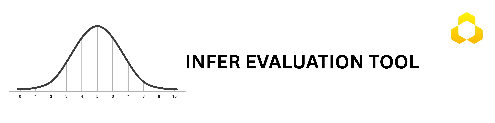

# Confidence Intervals for Evaluation Metrics



[](https://opensource.org/licenses/MIT)
[](https://www.python.org/downloads/)

This is a standardized evaluation tool that computes common machine learning metrics, such as Accuracy and MSE, and returns their confidence intervals using bootstrap and other statistical methods.

# Why Do We Need Confidence Intervals for Reliable AI Model Evaluation?

In practice, teams often ship (or reject) models based on single-number metrics computed on small or shifting test sets. When the metric is noisy, tiny changes in data, random seeds, or sampling can look like “regressions” or “breakthroughs” that are not real—creating wasted iteration, broken trust with stakeholders, and brittle release decisions.

A real example: years ago, before founding HumbleBee.AI, a colleague of Jumabek Alikhan was building a YOLO detector for a German client. Early evaluation on a small test set reported mAP ≈ 40%. After collecting more data and expanding train/test, the reported mAP dropped to ≈ 36%, and the client assumed the model had degraded. Jumabek was brought in to investigate. The issue was not a YOLO “bug,” but statistical uncertainty: the original 40% came from a small test set with an extremely wide 95% confidence interval (roughly 20%–60%), while the 36% on the larger test set had a tighter, more reliable interval (roughly 30%–42%). Communicating that uncertainty resolved the dispute and aligned the team on the true model trajectory.

That mindset—treating evaluation as statistical inference, not a single-point score—shaped how Jumabek later built HumbleBee.AI: delivering production ML with defensible measurement, not dashboard optimism. infer-ci is the open-source extraction of that one principle, packaged so any team can attach confidence intervals to the metrics they already report and make release decisions on stable evidence.

## The Motivation

Computing confidence intervals when providing performance estimates has not been sufficiently studied. Over the years, researchers have proposed multiple CI estimation methods in different fields, including medical statistics, AutoML, and text classification. Each method has specific assumptions, strengths, and limitations. However, most approaches are designed for a single metric or a narrow class of models, which limits their applicability.

We have developed a standardized evaluation tool that computes model performance metrics with their confidence intervals (CIs), including multiple CI calculation methods (bootstrapping, Wald, Wilson, etc.) and clear visualization graphs. It supports ML, CV, and LLM applications.

## Installation

### From PyPI (Recommended)

```bash
pip install infer-ci
```

### From Source (Development)

```bash
git clone https://github.com/humblebeeai/infer-ci.git
cd infer-ci
pip install -e ".[dev]"
```

For virtual environment setup, see the [Installation Guide](docs/getting-started/installation.md).

## Getting Started

```python
from infer_ci import MetricEvaluator
from infer_ci import accuracy_score, precision_score, tpr_score, f1_score
from infer_ci import mae, mse, rmse, r2_score, iou

# Classification example
y_true = [0, 1, 1, 0, 1]
y_pred = [0, 1, 0, 0, 1]

evaluator = MetricEvaluator()

accuracy, ci = evaluator.evaluate(
    y_true=y_true,
    y_pred=y_pred,
    task="classification",
    metric="accuracy",
    method="wilson",
    # plot=True  # Supported in Bootstrap methods
)

print("Accuracy:", accuracy)
print("Confidence interval:", ci)
```

## Confidence Interval Methods and Defaults

`MetricEvaluator.evaluate()` uses the Bootstrap Bias-Corrected and Accelerated (BCa) method by default. BCa bootstrap intervals adjust for bias and skewness in the estimate.

Other methods can be selected by specifying a method supported by the chosen metric. For example, `method="wilson"` can be used for accuracy, while bootstrap methods can be used for bootstrap resampling. Regression metrics also support the jackknife method.

Set `random_state` where supported to make bootstrap results reproducible with the same data and library versions.

## Supported Methods

- **Analytical Methods**: Wilson, Normal, Agresti-Coull, Beta, Jeffreys, Binomial test
- **Bootstrap Methods**: Bootstrap Basic, Bootstrap Percentile, Bootstrap Bias-Corrected and Accelerated (BCa)
- **Jackknife Method**: Jackknife

**Core Metrics Available via MetricEvaluator:**

### Classification

- `accuracy`: Overall classification accuracy
- `precision`: Positive Predictive Value (PPV)
- `recall`: True Positive Rate / Sensitivity (TPR)
- `specificity`: True Negative Rate (TNR)
- `npv`: Negative Predictive Value
- `fpr`: False Positive Rate
- `f1`: F1 Score (supports averaging)
- `precision_takahashi`: Precision using the Takahashi method
- `recall_takahashi`: Recall using the Takahashi method
- `auc`: ROC AUC Score

### Regression

- `mae`: Mean Absolute Error
- `mse`: Mean Squared Error
- `rmse`: Root Mean Squared Error
- `r2`: Coefficient of Determination
- `mape`: Mean Absolute Percentage Error
- `iou`: Intersection Over Union

### Object Detection

Overall and per-class metrics:

- `map`: Mean Average Precision 0.5:0.95
- `map50`: Mean Average Precision 0.5
- `precision`: Precision
- `recall`: Recall

📖 **For object detection metrics usage examples, see the [Object Detection Metrics Usage Guide](docs/object-detection-metrics-usage.md).**

📚 **Try the [Online Version](https://infer.humblebee.ai).**

## Inspect Available Methods and Metrics

You can inspect the available methods and metrics programmatically:

```python
from infer_ci import MetricEvaluator

evaluator = MetricEvaluator()

# Get available methods
classification_methods = evaluator.get_available_methods("classification")
regression_methods = evaluator.get_available_methods("regression")

print("Classification methods:", classification_methods)
print("Regression methods:", regression_methods)

# Get available metrics
classification_metrics = evaluator.get_available_metrics("classification")
regression_metrics = evaluator.get_available_metrics("regression")

print("Classification metrics:", classification_metrics)
print("Regression metrics:", regression_metrics)
```

The analytical computation is based on the 2022 paper by Takahashi et al. The paper derived recall and precision confidence intervals for micro averaging. We also derive recall and precision confidence intervals for macro F1 using the delta method.

## Get a Classification Report

The `classification_report_with_ci` function builds a text report showing the main classification metrics and their confidence intervals.

Each class is treated as a binary classification problem. Wilson is used by default for precision and recall, and Takahashi-binary is used for F1. Micro and macro multi-class metrics are then calculated using the Takahashi methods.

```python
from infer_ci import classification_report_with_ci

y_true = [0, 1, 2, 2, 2, 1, 1, 1, 0, 2, 2, 1, 0, 2, 2, 1, 2, 2, 1, 1]
y_pred = [0, 1, 0, 0, 2, 1, 1, 1, 0, 2, 2, 1, 0, 1, 2, 1, 2, 2, 1, 1]

report = classification_report_with_ci(y_true, y_pred)
print(report)
```

## Binary, Macro, and Micro Averaging for F1, Precision, and Recall

The F1, precision, and recall metrics support different averaging options. Use binary labels when selecting `average="binary"`.

```python
from infer_ci import precision_score, recall_score, f1_score

# Example binary classification data
y_true = [0, 1, 1, 0, 1, 0, 1, 0] * 10
y_pred = [0, 1, 0, 0, 1, 1, 1, 0] * 10

binary_f1, binary_ci = f1_score(
    y_true, y_pred, confidence_interval=0.95, average="binary"
)

macro_f1, macro_ci = f1_score(
    y_true, y_pred, confidence_interval=0.95, average="macro"
)

micro_f1, micro_ci = f1_score(
    y_true, y_pred, confidence_interval=0.95, average="micro"
)

bootstrap_binary_f1, bootstrap_ci = f1_score(
    y_true,
    y_pred,
    confidence_interval=0.95,
    average="binary",
    method="bootstrap_bca",
    n_resamples=5000
)
```

## Citation

If you use this library for research, please cite it. Here is an example BibTeX entry:

```bibtex
@misc{infer-ci,
  title={Confidence intervals for evaluation metrics},
  author={HumbleBee ai},
  year={2025},
  publisher={GitHub},
  howpublished={\url{https://github.com/humblebeeai/infer-ci}},
}
```

## References

- A Python library for confidence intervals: https://github.com/jacobgil/confidenceinterval
- Confidence Interval Estimation of Predictive Performance in the Context of AutoML: https://arxiv.org/abs/2406.08099v1
- The binomial confidence interval computation uses the statsmodels package: https://www.statsmodels.org/dev/generated/statsmodels.stats.proportion.proportion_confint.html
- Yandex Data School implementation of the fast DeLong method: https://github.com/yandexdataschool/roc_comparison
- X. Sun and W. Xu, "Fast Implementation of DeLong’s Algorithm for Comparing the Areas Under Correlated Receiver Operating Characteristic Curves," IEEE Signal Processing Letters, vol. 21, no. 11, pp. 1389–1393, Nov. 2014. https://ieeexplore.ieee.org/document/6851192
- https://www.ncbi.nlm.nih.gov/pmc/articles/PMC8936911/#APP2
- Kanae Takahashi, Kouji Yamamoto, Aya Kuchiba, and Tatsuki Koyama, "Confidence interval for micro-averaged F1 and macro-averaged F1 scores."
- B. Efron and R. J. Tibshirani, *An Introduction to the Bootstrap*, Chapman & Hall/CRC, Boca Raton, FL, USA (1993).
- Nathaniel E. Helwig, "Bootstrap Confidence Intervals": http://users.stat.umn.edu/~helwig/notes/bootci-Notes.pdf
- Bootstrapping (statistics), Wikipedia: https://en.wikipedia.org/wiki/Bootstrapping_(statistics)
